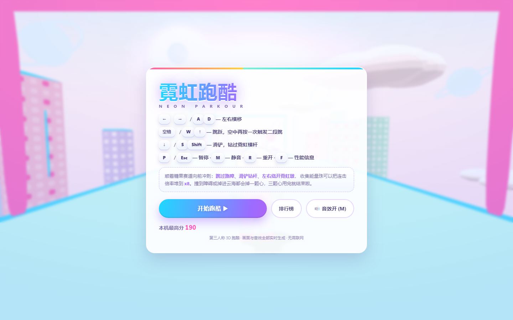
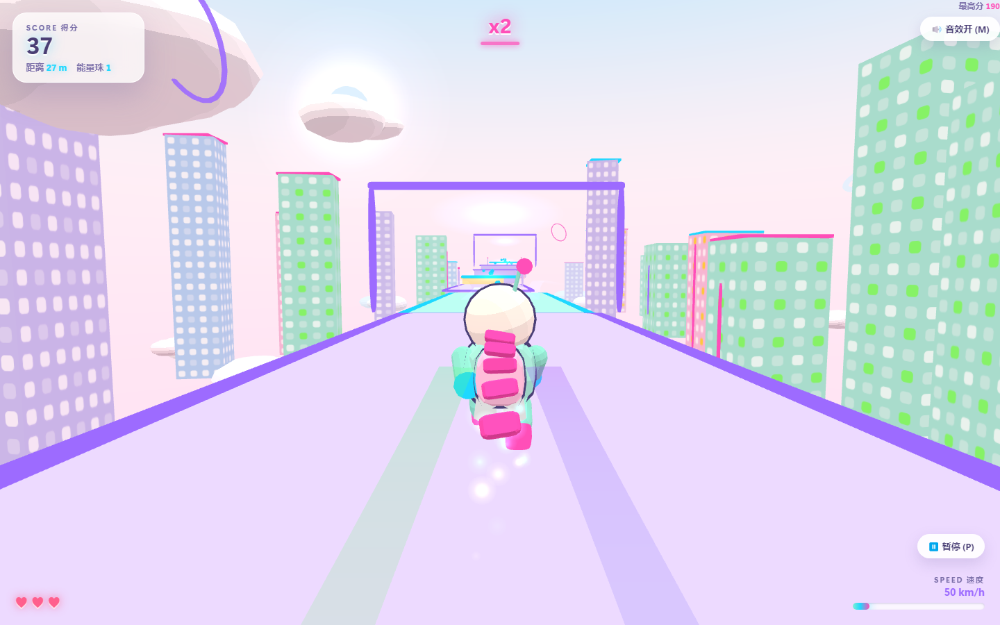
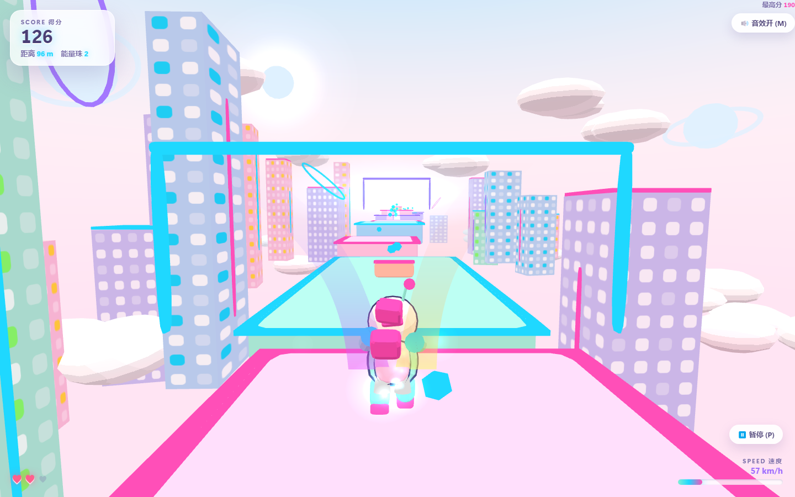
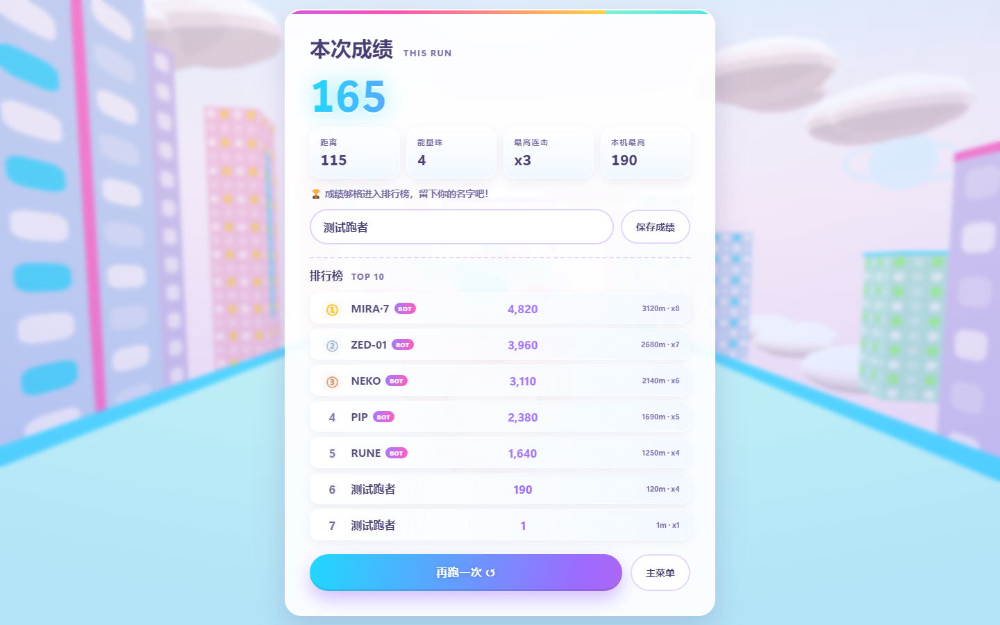

# 霓虹跑酷 · NEON PARKOUR

一个第三人称 3D 跑酷小游戏：**浅色小清新卡通画面 + 赛博朋克霓虹点缀**。
糖果色的浮空赛道、粉彩霓虹城市、圆润的卡通小机器人，配上实时合成的音效与自适应 BGM。

**没有任何外部资源**：3D 模型、贴图、音效、音乐、赛道全部在运行时生成，不需要联网。



| 跑动中（霓虹门 / 拖尾 / 能量珠） | 二段跳 + 霓虹城市 |
| --- | --- |
|  |  |



---

## 快速开始

| 方式 | 怎么做 | 说明 |
| --- | --- | --- |
| **单文件版（推荐）** | 双击 `dist/neon-parkour.html` | three.js 与全部代码都内联在一个文件里，**双击就能玩、可离线、可直接发给别人** |
| 开发版 | 双击 `index.html` | 需要 `three.min.js` 与 `js/` 目录在旁边，方便改代码 |

浏览器：Chrome / Edge / Firefox 等现代浏览器（需要 WebGL2）。手机也能玩（触屏目前只做了展示，操作以键盘为准）。

> 首次进入后按一下开始键或点击按钮，浏览器才允许播放声音（自动播放策略）。

---

## 分享给别人玩（4 种方式）

### 1. 直接发文件 —— 零配置，最快

把 `dist/neon-parkour.html`（745 KB，单文件）发给朋友，对方双击用浏览器打开就能玩。
聊天软件有时会拦截 `.html` 附件，那就发 **`dist/neon-parkour-share.zip`**（解压后同样是双击即玩）。

- 优点：不用服务器、不用账号、完全离线可玩。
- 缺点：对方得先把文件存到电脑上；**手机浏览器打开本地 html 很麻烦**，手机用户建议用下面的网址方式。

### 2. GitHub Pages —— 一条命令，拿到可分享的网址（手机也能玩）

前提：装好 [GitHub CLI](https://cli.github.com/)（`winget install --id GitHub.cli -e`）并登录一次（`gh auth login`）。

```bash
bash tools/deploy-github.sh            # 默认仓库名 neon-parkour
bash tools/deploy-github.sh my-game    # 也可以自定义仓库名
```

脚本会自动：创建公开仓库 → 推送代码 → 开启 GitHub Pages → 轮询直到网址可访问，最后打印：

```
https://<你的用户名>.github.io/neon-parkour/
```

把网址发出去，任何人（含手机）点开就能玩，改完代码 `git push` 一下站点就更新。

> 注意：`github.io` 在国内网络环境有时打不开或很慢。如果朋友主要在国内，优先用下面的方式 3。

### 3. 国内可访问的静态托管

游戏就是纯静态文件，任何静态托管都能放，把仓库文件（或单文件版）传上去即可：

| 平台 | 做法 | 备注 |
| --- | --- | --- |
| 腾讯云 COS / 阿里云 OSS | 上传文件 → 开启「静态网站托管」 | 国内访问快，需实名账号，费用极低 |
| Cloudflare Pages | 连接 GitHub 仓库，框架选 None | 免费、自动 HTTPS，国内可访问性一般 |
| Netlify Drop / Vercel | 拖拽 `neon-parkour` 目录上传 | 国内访问不稳定 |

### 4. 局域网临时开一局

同一 WiFi 下，在自己电脑起个静态服务，把本机内网 IP 发给同事：

```bash
node tools/dev-server.mjs . 8899     # 然后访问 http://<你的内网IP>:8899/index.html
```

---

## 操作

| 按键 | 作用 |
| --- | --- |
| `←` `→` / `A` `D` | 左右横移（空中也可微调） |
| `空格` / `W` / `↑` | 跳跃；**空中再按一次 = 二段跳**（带翻滚动画） |
| `↓` / `S` / `Shift` | 滑铲：钻过霓虹横杆，并短暂加速 |
| `P` / `Esc` | 暂停 / 继续 |
| `M` | 静音开关（会被记住） |
| `R` | 重开一局 |
| `F` | 显示性能信息（fps / draw call 数） |

手感细节：土狼时间（0.13s）、跳跃输入缓冲（0.14s）、可变跳跃高度（松手即削顶）、
台阶宽容（差一点点也能踩上去）、撞击后短暂无敌 —— 都按"休闲友好"来调。

---

## 玩法

- 角色**自动向前冲刺**，速度从 13 m/s 逐渐升到 30 m/s，你只负责左右、起跳与滑铲。
- 障碍三种，各自对应一个正确解法：
  - **霓虹横杆**（空中灯管）：必须 `滑铲` 通过，站着撞上去会掉血；
  - **跨栏**（矮墩）：必须 `跳跃` 越过；
  - **方块墩 / 旋转棱锥**：侧向绕开。
- 收集**能量珠**：每颗 +10 × 当前连击倍率，连击最高 **x8**，2.6 秒不拾取会回落。
- 三颗心：撞到障碍或掉进云海各扣一颗，扣完结算。掉落后会回到最近的安全落脚点。
- 得分 = 距离 + 能量珠分数，结束后可留名进入**本机排行榜（TOP 10，localStorage 持久化）**。

---

## 技术实现

**画面**
- `MeshToonMaterial` + 4 段色阶渐变贴图 = 赛璐璐卡通质感；浅色半球光 + 一盏主平行光（软阴影），刻意压低光强避免过曝。
- 平台用 `ExtrudeGeometry` 的圆角方块 + 不受光的高饱和"霓虹边框"，俯视是糖果台面的发光描边。
- 天空是渐变穹顶着色器，配粉彩太阳、环形星球、云海与远景粉彩霓虹城市（程序化窗格贴图）。
- 自适应画质：帧率掉到 46 以下自动降分辨率、关阴影、减粒子；回到 57 以上再恢复。

**特效**
- 双条**霓虹缎带拖尾**（定长采样 + 侧面扩展 + 顶点色流动），侧向甩出避免遮挡角色。
- 两套 GPU 点精灵粒子（火花用加法混合、尘雾用普通混合），单 draw call；拾取/落地/撞击各有专门爆发。
- 世界空间飘字（+20 / COMBO）。

**音频**（`js/10_audio.js`，纯 WebAudio 合成，无音频文件）
- BGM：五声音阶琶音 + 弹拨贝斯 + 柔和 pad + 轻鼓，带反馈延迟；速度越快越"燃"（`Audio.setIntensity`）。
- 音效：跳跃、二段跳、落地（按冲击力变化）、滑铲、拾取（音高随连击升高）、撞击、坠落、结束、一血心跳。
- 已处理浏览器自动播放策略：长时间挂起后重新对齐调度，不会补排音符爆音。

**逻辑**
- 1/120s 定步长物理 + 逐轴 AABB 分离求解；碰撞盒查询按玩家附近裁剪。
- 赛道分「段」程序化生成，7 种样式（长直道 / 跳跃间隙 / 阶梯 / 浮空小岛 / 窄梁 / Z 字绕行 / 双道分流），
  难度用两条独立曲线控制：`difficulty`（缝隙与宽度）与 `pressure`（障碍密度），
  且保证所有缝隙都在基础速度的跳跃射程内 —— 一定过得去，只是越来越挤。
- 段落滚动回收，几何与材质全局缓存共享，长时间跑不会涨内存。

---

## 目录结构

```
neon-parkour/
├─ index.html              # 开发版入口（HTML + CSS + UI 结构）
├─ three.min.js            # three.js r149（MIT），本地化以便离线运行
├─ js/
│  ├─ 00_core.js           # 调色板 / 数学 / 程序化贴图 / 几何与材质缓存
│  ├─ 10_audio.js          # WebAudio 合成：BGM 与全部音效
│  ├─ 20_board.js          # 排行榜（localStorage）
│  ├─ 30_fx.js             # 粒子系统 / 霓虹缎带 / 飘字
│  ├─ 40_world.js          # 天空、云海、程序化赛道与城市装饰
│  ├─ 50_player.js         # 角色建模、动画、跑酷物理
│  └─ 60_game.js           # 主循环、相机、输入、UI 联动
├─ dist/
│  ├─ neon-parkour.html       # 单文件版（双击即玩，可直接分享）
│  └─ neon-parkour-share.zip  # 上面那个文件的压缩包（发邮件/聊天更保险）
├─ docs/screenshots/       # README 配图
└─ tools/                  # 开发与验收工具（不影响游戏运行）
   ├─ dev-server.mjs       # 本地静态服务器（禁用缓存，避免改代码后浏览器吃旧文件）
   ├─ verify.mjs           # 无头 Chrome 自动验收：跑一局 + 截图 + 断言
   ├─ check-palette.mjs    # 静态检查：调色板键是否都存在
   ├─ build-standalone.mjs # 打包单文件版
   └─ deploy-github.sh     # 一键发布到 GitHub Pages
```

## 开发者用法

```bash
# 本地起服务（改代码即时生效）
node tools/dev-server.mjs . 8899        # 然后访问 http://127.0.0.1:8899/index.html

# 调色板静态检查
node tools/check-palette.mjs

# 无头浏览器自动验收（不弹窗口、不抢焦点）
node tools/verify.mjs                  # 全部场景
node tools/verify.mjs menu play jump   # 指定场景
#   场景: menu / play / jump / slide / sound / gameover / board / mechan / perf / stall
#   截图输出到 tools/shots/
#   可用环境变量覆盖：CHROME_PATH / CHROME_PROFILE / CDP_PORT / WEB_PORT

# 重新打包单文件版
node tools/build-standalone.mjs

# 发布到 GitHub Pages（需要先 gh auth login）
bash tools/deploy-github.sh
```

`verify.mjs` 会在无头 Chrome 里真实加载页面、用可信输入事件操作、驱动一局并断言：
横杆必须滑铲、跨栏必须跳、方块必须绕行、排行榜能存能读、AudioContext 在手势后恢复、
BGM 调度器在推进、以及全程零控制台报错。

---

## 说明

- 排行榜里带 **BOT** 标记的五条是内置的"街区 NPC"成绩，用来当追赶目标；你自己的成绩会正常参与排序。
- 「本机最高分」只统计你自己的成绩，不含 NPC。
- 排行榜与静音偏好存在浏览器 localStorage，换浏览器 / 清缓存会重新开始。
- 内置的 `three.min.js` 为 three.js r149（MIT 许可，版权声明见文件头）。
